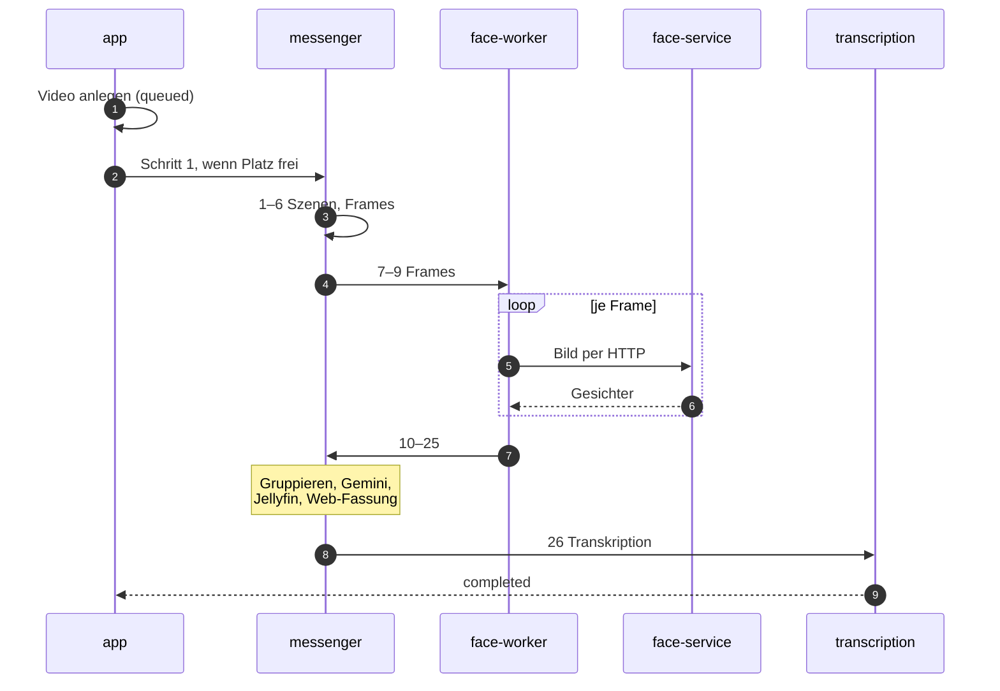
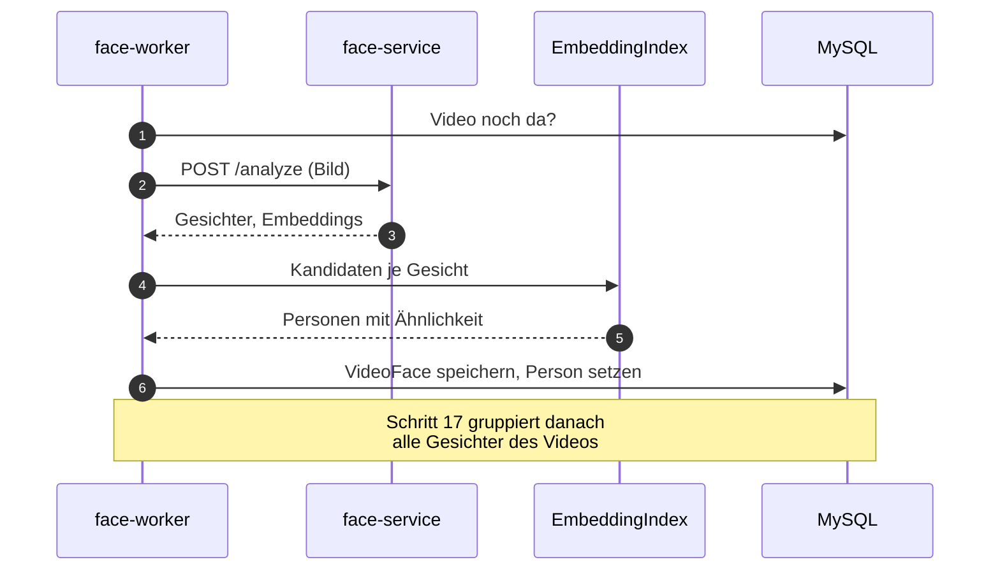
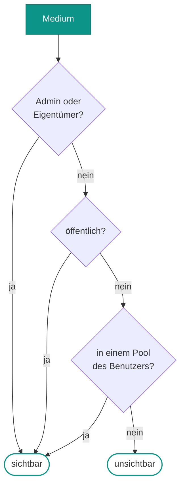
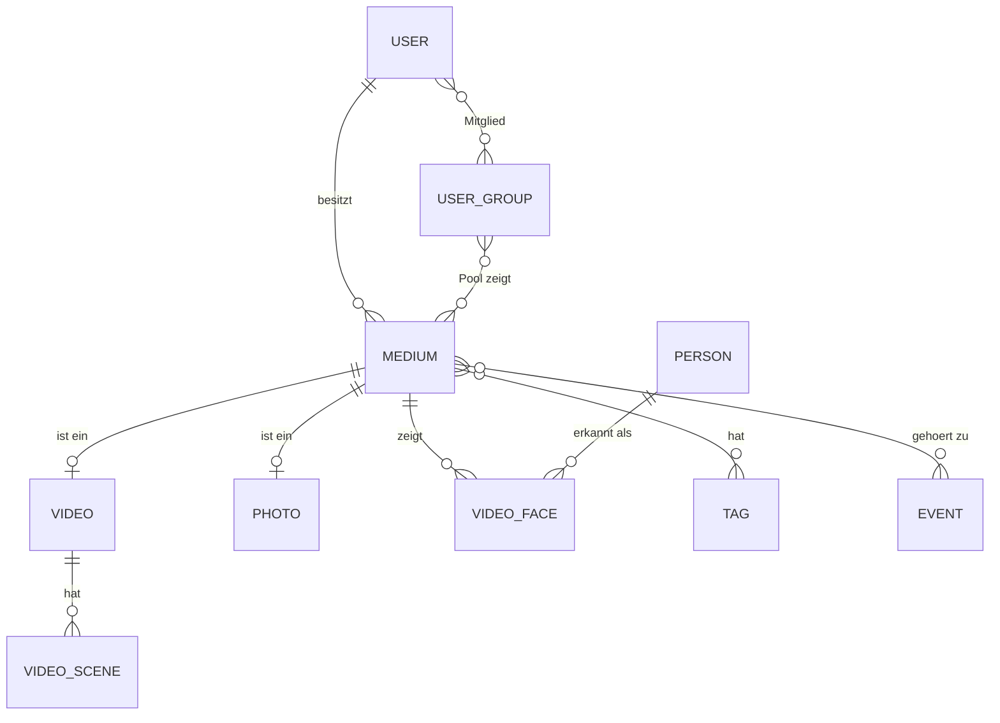
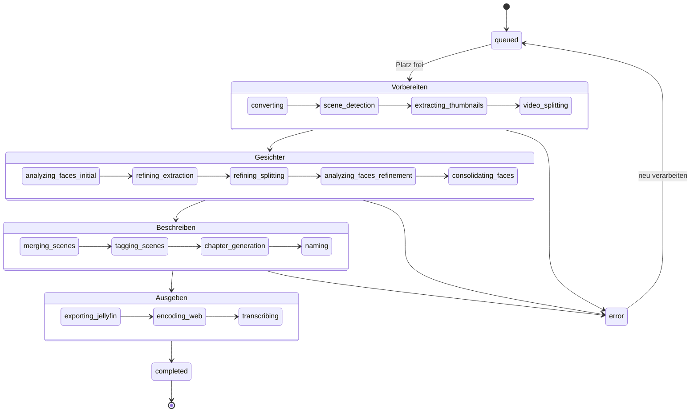
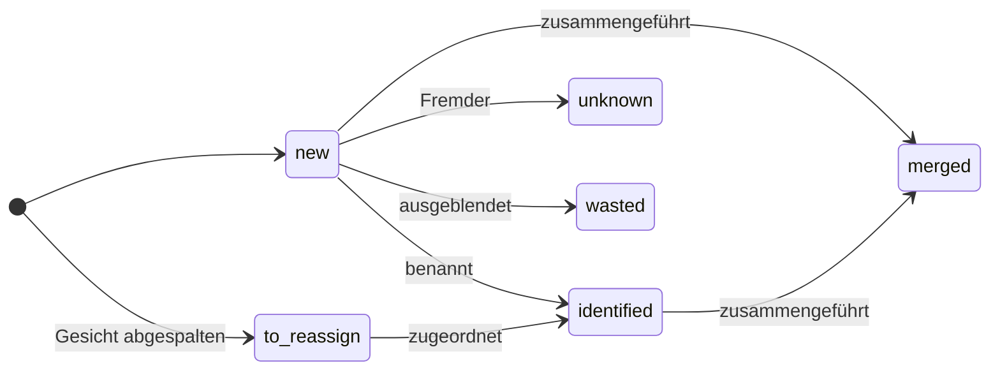
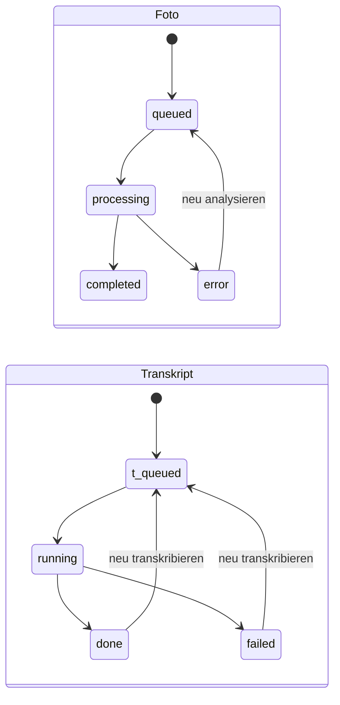

# Aufbau

## Vom Band ins Archiv

Was mit einem Video passiert, nachdem es hochgeladen wurde:

<ol>
<li data-title="Hochladen" data-where="Browser" data-icon="browser" data-label="max. 2 parallel">

Dateien oder ganze Ordner unter <code>/upload</code>, große Mengen über den Import-Ordner. Der Browser rechnet vorab den SHA-256 aus und überspringt Dateien, die es schon gibt. Danach wartet das Video auf <code>queued</code>: Höchstens zwei laufen gleichzeitig durch die Pipeline, damit abyss für die anderen Projekte frei bleibt.

</li>
<li data-title="Zerlegen" data-where="messenger-worker" data-icon="video" data-label="Frames">

In MP4 umwandeln (alte Bänder werden entschachtelt), Aufnahmedatum lesen, Szenen erkennen, Vorschaubilder und Einzelbilder ziehen.

</li>
<li data-title="Gesichter" data-where="face-worker" data-icon="users" data-label="Personen">

Jedes Einzelbild geht an InsightFace. Gefundene Gesichter werden bekannten Personen zugeordnet, vorgeschlagen oder als neue Person angelegt, dann im ganzen Video gruppiert.

</li>
<li data-title="Texte" data-where="Gemini" data-icon="sparkle" data-label="Export">

Schlagworte je Szene, Kapitel und ein Titelvorschlag. Danach Export nach Jellyfin und eine leichte Web-Fassung (höchstens 1080p) fürs Ansehen von unterwegs.

</li>
<li data-title="Transkript" data-where="transcription-worker" data-icon="check">

Zum Schluss verschriftlicht Whisper den Ton. Das Video ist ab jetzt fertig, durchsuchbar und in Jellyfin mit Untertiteln.

</li>
</ol>

Technisch ist jeder der 26 Schritte eine eigene Messenger-Message. Die Kette wechselt zwischen drei Workern, je nach
Art der Arbeit:

*Der Ablauf eines Videos über die drei Worker (`messenger` = messenger-worker, `transcription` =
transcription-worker). Die dichtere Nachanalyse für Szenen ohne Gesicht (Schritte 14–16) läuft ebenfalls über den
face-worker; zur Übersicht weggelassen.*

| Queue | Worker | Was |
|---|---|---|
| `async_video_processing` | messenger-worker | alle Pipeline-Schritte außer Gesichtern und Transkription |
| `async` | messenger-worker | Import-Ordner, sonstige Hintergrundjobs |
| `photos` | messenger-worker | Foto-Analyse, Web-Fassungen nachträglich (niedrigste Priorität) |
| `scheduler_default` | messenger-worker | Zeitplan: Import-Ordner alle 5 Minuten prüfen (wenn eingeschaltet) |
| `face_recognition` | face-worker | Gesichter je Frame; genau ein Consumer, 3 Wiederholungen |
| `transcription` | transcription-worker | Whisper; ein Job zur Zeit, keine Wiederholung |

Scheitert ein Schritt endgültig, steht das Video auf **Fehler** mit Grund. Scheitern nur Web-Fassung oder
Transkription, ist das Video trotzdem fertig. Fotos laufen kürzer: drehen und verkleinern, EXIF und GPS lesen,
Gesichter (über denselben face-service), Gemini-Titel und -Tags, Suchindex.

## Wer ist das?

<ol>
<li data-title="Neues Gesicht" data-where="Pipeline" data-icon="image" data-label="Vergleich">

InsightFace liefert für jedes Gesicht einen Merkmalsvektor. Verglichen wird mit bis zu 20 guten Referenzbildern je Person, verteilt über die Aufnahmejahre.

</li>
<li data-title="Zuordnen" data-where="FaceAssigner" data-icon="users" data-label="Vorschlag">

Sehr ähnlich: direkt der Person zugeordnet. Etwas weniger: als Vorschlag gemerkt. Sonst: eine neue, unbenannte Person.

</li>
<li data-title="Benennen" data-where="Bearbeiter" data-icon="edit" data-label="bestätigt">

Im Tinder-Stil, auf der Ereignisseite („Wer ist dabei?“) oder über „Doppelte Personen“. Namenshinweise kommen aus dem Transkript.

</li>
<li data-title="Überall" data-where="Archiv" data-icon="search">

Gleicher Name heißt zusammenführen. Die Person ist in Suche, Zeitachse und API zu finden; von Hand bestätigte Gesichter überstehen jede Neuanalyse.

</li>
</ol>

*Ein Frame im face-worker. Der face-service sieht keine Dateien und keine Personen, er rechnet nur. Den Abgleich
macht PHP. Schwellen sind unter Verwalten → Gesichtserkennung einstellbar.*

!!! warning "Grundsatz bei alten Bändern"
    Erkannt wird immer auf dem digitalisierten Original, nie auf Material mit KI-Gesichtsrestaurierung. Solche Modelle
    erfinden Gesichtsdetails und verfälschen die Identität.

## Teilen mit Oma

<ol>
<li data-title="Link anlegen" data-where="Ereignis- oder Videoseite" data-icon="key" data-label="/s/…">

Karte „Teilen“: gültig 1 bis 90 Tage oder unbegrenzt, optional Passwort, Download der Originale erlauben oder nicht, Notiz „für Oma“.

</li>
<li data-title="Öffnen" data-where="Browser ohne Konto" data-icon="phone" data-label="Prüfung">

Bei jedem Aufruf werden Ablauf, Zurückziehen und Passwort geprüft. Höchstens 10 Passwortversuche je 15 Minuten.

</li>
<li data-title="Ansehen" data-where="Empfänger" data-icon="play">

Nur Medien, die der Ersteller selbst sehen darf. Keine Gesichter, Personen, Tags oder Transkripte; Videos als Web-Fassung direkt aus dem Speicher.

</li>
</ol>

## Wer was sieht

*Eine Regel für Listen, Zeitachse, Suche, Karte, Ereignisse, Share-Links und API (`MediumRepository::
visibleCondition()`). In einen Pool kommt ein Medium per Regel (Ereignis, Tag, Zeitraum) oder einzeln.*

| Rolle | Darf |
|---|---|
| Familie (`ROLE_USER`) | ansehen: Zeitachse, Ereignisse, Karte, Suche – öffentliche Medien und die der eigenen Pools |
| Bearbeiter (`ROLE_EDITOR`) | zusätzlich hochladen, Personen benennen und verwalten |
| Admin (`ROLE_ADMIN`) | alles, sieht alle Medien, verwaltet Benutzer, Pools, API-Zugänge |

## Datenmodell

*Die zentralen Entities. Video und Foto erben von `Medium` (Class Table Inheritance, Tabellen `medium`, `video`,
`photo`), deshalb sind Gesichter, Tags, Ereignisse und Rechte für beide gleich. `VideoFace` heißt historisch so und
gilt auch für Fotos.*

- **Medium**: Titel, Aufnahmezeit mit Herkunft (EXIF, Dateiname, DV-Kassette, von Hand), Kamera, Ort, Eigentümer,
  öffentlich ja/nein.
- **Person**: Name, Status, Profilbild; zusammengeführte Personen bleiben als `merged` mit Verweis erhalten.
- **Event**: Ereignis bzw. Album mit Zeitraum und beliebig vielen Medien.
- **UserGroup** ist ein Pool; Regeln (`PoolRule`: Ereignis, Tag, Zeitraum) nehmen passende Medien automatisch auf.
- **VideoScene** hat eigene Tags und Gesichter; **ShareLink** zeigt auf ein Ereignis oder ein Medium.
- Daneben: Kapitel, Transkript mit Abschnitten, DV-Aufnahmesegmente, Verarbeitungsschritte je Video,
  Kamera-Uhr-Korrekturen, Einstellungen für Gesichtserkennung und Transkription.

## Zustände

### Video

*Die State Machine `video_processing` in vier Phasen. `queued` liegt außerhalb der State Machine: Dort warten Videos,
bis die Import-Warteschlange sie startet. Neu verarbeiten entfernt alte Szenen und Gesichter, behält aber benannte
Personen und bestätigte Gesichter.*

### Person, Foto, Transkript

*Personenstatus. Automatisch angelegte Personen ohne Gesicht werden aufgeräumt; benannte Personen bleiben immer.
Daneben gibt es noch `archived` zum späteren Aussortieren.*

*Foto-Analyse und Transkription. `t_queued` ist der Zustand `queued` des Transkripts.*

Mehr Details:
[Pipeline](https://github.com/rextuus/momentary/blob/main/documentation/processing_pipeline.md) ·
[Gesichtserkennung](https://github.com/rextuus/momentary/blob/main/documentation/face_recognition.md) ·
[Transkription](https://github.com/rextuus/momentary/blob/main/documentation/transcription.md) ·
[DV-Aufnahmedatum](https://github.com/rextuus/momentary/blob/main/documentation/dv_aufnahmedatum.md) ·
[Medien, Ereignisse, Karte](https://github.com/rextuus/momentary/blob/main/documentation/media.md) ·
[Pools](https://github.com/rextuus/momentary/blob/main/documentation/pools.md) ·
[Share-Links](https://github.com/rextuus/momentary/blob/main/documentation/sharing.md)
