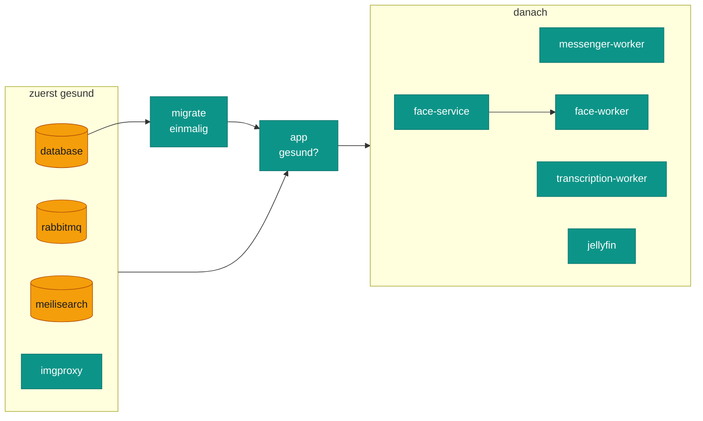

# Betrieb

Momentary läuft als Komodo-Stack `momentary` auf abyss (`compose.prod.yaml`, Projektname `momentary`). Die
Komodo-Ressourcen (Stack und Backup-Procedure) kommen per Resource Sync aus
[`deploy/komodo/momentary.toml`](https://github.com/rextuus/momentary/blob/main/deploy/komodo/momentary.toml).
Automatische Deploys sind aus; deployt wird bewusst von Hand.

## Deploy

<div class="hl-steps" markdown>

1. **Pushen**
   Auf den Server kommt nur, was auf `main` in GitHub liegt. Ändert sich `momentary.toml` (z. B. Environment), in
   Komodo zuerst den Sync ausführen.
2. **Optional: Warteschlangen leer laufen lassen**
   Ein Deploy unterbricht laufende Analysen (werden neu zugestellt) und startet eine laufende Transkription von vorn.
   Prüfen: *Verwalten → Warteschlange* oder `dc exec -T rabbitmq rabbitmqctl list_queues name messages`.
3. **Komodo → Stack `momentary` → Deploy**
   Pre-Deploy prüft Variablen und `VOLUME_PREFIX` und schreibt einen Dump `momentary-db-…-pre-deploy.sql.gz`.
   Fehlt etwas, bricht er ab, bevor sich irgendetwas ändert.
4. **Bauen und starten**
   Image bauen (beim ersten Mal ca. 10 Minuten), `migrate` läuft einmal, dann `up -d --wait`: Der Deploy ist erst
   grün, wenn alle Dienste gesund sind (bis zu 600 s).
5. **Post-Deploy**
   Zustand und `/healthz` ins Deploy-Log, alte Momentary-Images aufräumen.
6. **Kurz prüfen**
   `https://admin.momentary.wh-company.com/login` laden, einmal anmelden, ein Vorschaubild muss erscheinen.

</div>

## Rollback

<div class="hl-steps" markdown>

1. **Letzten guten Commit eintragen**
   In `momentary.toml` `commit = "<hash>"` setzen, pushen, Sync, Deploy. (Im Komodo-UI geht es auch, der nächste
   Sync setzt es aber zurück.)
2. **Datenbank zurück, falls Migrationen liefen**
   Das alte Schema passt nicht zu neuen Migrationen: vorher den Dump `…-pre-deploy.sql.gz` dieses Deploys
   einspielen ([Daten → Wiederherstellen](daten.md#datenbank-wiederherstellen)).
3. **Aufräumen**
   Danach `commit = ""` wieder leeren, damit der Stack wieder `main` folgt.

</div>

!!! danger "Wenn `migrate` fehlschlägt"
    Dann starten `app` und die Worker nicht, die Seite ist unten, bis der Fehler behoben oder der Rollback durch
    ist. Ursache: `dc logs migrate`.

## Dienste



*Startreihenfolge: Worker und Jellyfin starten erst, wenn `app` gesund ist, der face-worker zusätzlich erst nach
face-service. `app` setzt beim Start die Rechte im Medienspeicher; erst danach dürfen andere darauf schreiben.*

| Dienst | Aufgabe | Grenzen |
|---|---|---|
| `app` | Weboberfläche, API, Video-Streams, `/imgproxy/` → imgproxy; einziger Host-Port `10.0.0.2:8194` | Healthcheck `/healthz` (bis zur DB) |
| `messenger-worker` | Pipeline, Fotos, Import-Ordner, Zeitplan | Neustart nach 1 h oder 512 MB |
| `face-worker` | Gesichter je Frame, genau ein Consumer | `nice 10` |
| `transcription-worker` | Whisper | `nice 15`, Neustart nach 2 h |
| `face-service` | InsightFace (CPU), kein Port | 2 CPUs, 2 GB, `cpu_shares 512` |
| `database` | MySQL 8.4 | |
| `rabbitmq` | Warteschlangen, Verwaltung nur per `exec` | |
| `meilisearch` | Suche (Indizes `videos`, `photos`) | |
| `imgproxy` | Bildvarianten, liest den Speicher nur lesend | 768 MB |
| `jellyfin` | Exportziel der Pipeline, nur intern | |
| `migrate` | Migrationen, einmal je Deploy | One-Shot |
| `backup` | Datenbank-Dump | nur auf Abruf |

Docker-Logs: höchstens 5 × 10 MB je Dienst. Das Netz `momentary_momentary-network` hat einen festen Namen, weil der
Hub (`momentary-hub`) sich daran hängt.

## Hintergrundjobs

| Was | Wann | Wo |
|---|---|---|
| Datenbank-Dump `daily` | täglich 02:00 (Europe/Berlin) | Komodo-Procedure `momentary-backup` |
| Datenbank-Dump `pre-deploy` | vor jedem Deploy | `deploy/komodo/pre-deploy.sh` |
| Import-Ordner prüfen und übernehmen | alle 5 Minuten, **nur mit `IMPORT_FOLDER_WATCH=1`** (Standard aus) | Symfony Scheduler im `messenger-worker` |
| Offsite-Sicherung von Dumps und Schlüsseln | nachts (homelab) | restic → B2, siehe homelab-Doku |
| Externe Überwachung | laufend | `https://admin.momentary.wh-company.com/healthz` (UptimeRobot) |

## Variablen

Komodo schreibt bei jedem Deploy `.env.prod.local` aus dem Environment in `momentary.toml`. Secrets sind
Komodo-Variablen `MOMENTARY_*` (Settings → Variables, Häkchen „Secret“). Die vollständige Liste mit Erklärung:
[`.env.prod.dist`](https://github.com/rextuus/momentary/blob/main/.env.prod.dist).

| Name | Zweck | Secret |
|---|---|---|
| `APP_SECRET` | Symfony-Secret (Sitzungen, signierte URLs) | ja |
| `MYSQL_PASSWORD`, `MYSQL_ROOT_PASSWORD` | Datenbank; gilt nur beim allerersten Start, **nie ändern** | ja |
| `RABBITMQ_PASS` | Warteschlange; wie oben, gehört zum Volume | ja |
| `MEILI_MASTER_KEY` | Suche | ja |
| `IMGPROXY_KEY`, `IMGPROXY_SALT` | Signatur der Bild-URLs | ja |
| `OAUTH_ENCRYPTION_KEY` | API-Tokens für Hub und App; Änderung macht ausgegebene Tokens ungültig | ja |
| `MAILER_DSN` | Mailversand; Momentary verschickt keine Mails | ja |
| `GEMINI_API_KEY` | Tags, Kapitel, Titel – **kostet Geld** | ja |
| `AWS_ACCESS_KEY`, `AWS_SECRET_KEY` | nur bei `FACE_RECOGNITION_PROVIDER=rekognition` – kostet Geld | ja |
| `JELLYFIN_API_KEY` | Export nach Jellyfin; wird erst nach dem ersten Start in Jellyfin angelegt | ja |
| `APP_PUBLIC_URL` | öffentliche Adresse für signierte Links und Bilder | nein |
| `HTTP_BIND`, `HTTP_PORT`, `REVERSE_PROXY_IPS` | Eingang über WireGuard vom VPS-Caddy | nein |
| `STORAGE_DIR`, `KEYS_DIR`, `BACKUP_DIR`, `BACKUP_KEEP` | Pfade unter `/srv/momentary`, Anzahl Dumps je Anlass | nein |
| `MYSQL_DATABASE`, `MYSQL_USER`, `RABBITMQ_USER`, `AWS_REGION` | feste Namen, gehören zu den Volumes | nein |
| `GEOCODING_ENABLED` | Ortsnamen über Nominatim | nein |
| `IMPORT_FOLDER_WATCH` | Import-Ordner automatisch übernehmen | nein |
| `FACE_RECOGNITION_PROVIDER` | `insightface` (Standard) oder `rekognition` | nein |
| `FACE_*` (DET_SIZE, MIN_DET_SCORE, Threads, Timeout, Vorfilter, Referenzen) | Feinheiten der Gesichtserkennung | nein |
| `VOLUME_PREFIX` | **nur für Probeläufe**; in Produktion nie setzen | nein |

!!! tip "Variable fehlt absichtlich"
    Soll ein Schlüssel (z. B. AWS) fehlen, die Zeile aus dem Environment in `momentary.toml` löschen. Eine nicht
    angelegte Komodo-Variable bleibt sonst wörtlich als `[[…]]` stehen, und der Pre-Deploy bricht ab.

## Häufige Befehle

=== "Produktion (abyss)"

    ```bash
    cd /etc/komodo/stacks/momentary
    alias dc='sudo docker compose -p momentary -f compose.prod.yaml --env-file .env.prod.local'

    dc ps                                                       # Zustand
    dc logs -f --tail=100 messenger-worker                      # Logs
    dc exec -u www-data app php bin/console app:user:create <E-Mail> --role=admin
    dc exec -u www-data app php bin/console messenger:failed:show
    dc exec -T -u www-data app php bin/console app:meilisearch:index-all
    dc exec -T rabbitmq rabbitmqctl list_queues name messages
    ```

=== "Lokal (Entwicklung)"

    ```bash
    make up                                    # baut und startet compose.yaml
    docker compose exec -T app vendor/bin/phpunit
    composer phpstan && composer cs            # Level 8, Mago
    ```

    Probeläufe von `compose.prod.yaml` lokal nur mit eigenem Projektnamen **und** `VOLUME_PREFIX`: Die Entwicklung
    heißt ebenfalls `momentary`. Anleitung im
    [Deployment-Dokument](https://github.com/rextuus/momentary/blob/main/documentation/deployment.md#probelauf-auf-dem-entwicklungsrechner).

Medien in den Import-Ordner legen: `rsync` nach `abyss:/srv/momentary/storage/imports/`, dann in der Oberfläche
*Verwalten → Import-Ordner*. SFTP gibt es in Produktion nicht.

Ersteinrichtung (Ordner, Schlüsselpaare, Komodo-Sync, Jellyfin einrichten, Domain freischalten) Schritt für Schritt:
[documentation/deployment.md](https://github.com/rextuus/momentary/blob/main/documentation/deployment.md#inbetriebnahme-erster-deploy).
