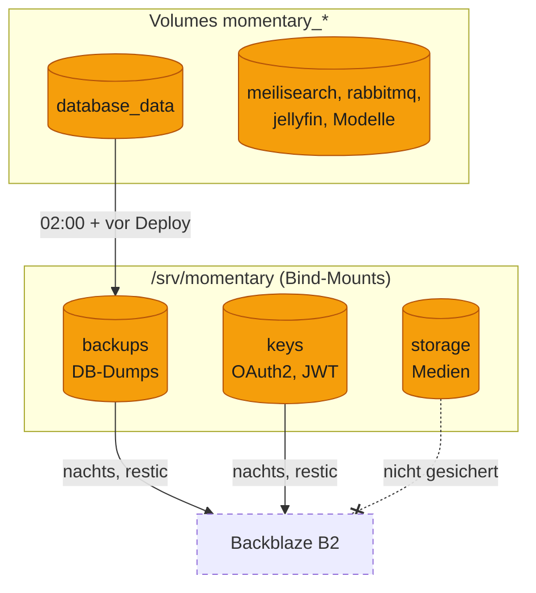

# Daten

Nichts liegt im Stack-Ordner `/etc/komodo/stacks/momentary` – Komodo darf ihn jederzeit neu klonen. Medien,
Schlüssel und Dumps liegen unter `/srv/momentary`, alles andere in Volumes mit festem Namen `momentary_*`.

*Offsite gehen nur die Dumps und die API-Schlüssel. Die Medien bleiben auf abyss, der Rest lässt sich neu aufbauen.*

| Was | Wo | Gesichert |
|---|---|---|
| Datenbank | Volume `momentary_database_data` | täglich 02:00 und vor jedem Deploy als Dump, Dumps offsite |
| Medien | `/srv/momentary/storage` | **nein** (zu groß für B2) |
| API-Schlüssel (OAuth2, JWT) | `/srv/momentary/keys/{oauth2,jwt}`, nur lesend eingebunden | offsite |
| Dumps | `/srv/momentary/backups` (700, Dateien 600) | offsite |
| Suchindex | Volume `momentary_meilisearch_data` | nein, `app:meilisearch:index-all` baut neu |
| Warteschlangen | Volume `momentary_rabbitmq_data` | nein |
| Jellyfin | Volumes `momentary_jellyfin_config`, `momentary_jellyfin_cache` | nein, schnell neu eingerichtet |
| Whisper-Modelle | Volume `momentary_whisper_models` | nein, lädt sich neu (~1,6 GB) |
| InsightFace-Modelle | Volume `momentary_face_models` | nein, lädt sich neu (~280 MB) |
| Secrets | Komodo-Variablen `MOMENTARY_*` | mit dem Komodo-Backup |

!!! danger "Medien sind nicht außer Haus gesichert"
    Ein Plattendefekt auf abyss heißt: Datenbank und Schlüssel lassen sich wiederherstellen, Videos und Fotos nicht.
    Die Originale also an anderer Stelle behalten oder `/srv/momentary/storage` regelmäßig auf eine zweite Platte
    spiegeln (`rsync -a`).

!!! warning "Volume-Namen nie umbenennen"
    Die Namen sind in `compose.prod.yaml` per `name:` festgelegt und hängen nicht am Projektnamen.

## Was im Medienspeicher liegt

| Ordner | Inhalt |
|---|---|
| `videos/<id>/` | Original bzw. MP4, Web-Fassung `web.mp4` |
| `photos/<id>/` | `original.<ext>`, `display.jpg` (max. 2560 px), `thumbnail.jpg` (max. 480 px) |
| `frames/<id>/` | Einzelbilder der Analyse (`app:video:cleanup-originals` räumt sie auf) |
| `images/faces/<id>/`, `images/profiles/` | Gesichtsbilder, Profilbilder |
| `imports/` | Import-Ordner; per Hash erkannte Doppelte wandern nach `_doppelt/` |
| `jellyfin/uploads/` | exportierte Videos mit Untertiteln, Bibliothek von Jellyfin |

Rechte: Die App legt Ordner mit `755` und Dateien mit `644` an und gehört `www-data` (33). imgproxy liest über die
Rechte für „andere“ – deshalb nie `700`/`600` auf den Speicher setzen.

## Sicherung

1. **Täglich**
   Komodo-Procedure `momentary-backup` um 02:00: `docker compose run --rm --no-TTY --no-deps backup daily`. Läuft
   der Stack nicht, scheitert sie absichtlich und Komodo meldet den Fehler.
2. **Vor jedem Deploy**
   Der Pre-Deploy schreibt `momentary-db-<zeit>-pre-deploy.sql.gz`; schlägt das fehl, wird nicht deployt.
3. **Von Hand**
   `dc run --rm --no-TTY backup manuell` vor riskanten Eingriffen.
4. **Rotation und Offsite**
   Je Anlass bleiben die neuesten 14 (`BACKUP_KEEP`). Die nächtliche Offsite-Sicherung des homelab nimmt
   `/srv/momentary/backups` und `/srv/momentary/keys` mit.

Dumps werden atomar über eine `.partial`-Datei geschrieben und erst nach erfolgreichem Abschluss umbenannt.

## Datenbank wiederherstellen

1. **Dump auswählen**
   `sudo ls -lt /srv/momentary/backups | head` – fürs Rollback der `pre-deploy`-Dump des fehlerhaften Deploys.
2. **Schreibende Dienste anhalten**
   `dc stop app messenger-worker face-worker transcription-worker`
3. **Einspielen**
   `sudo gunzip -c /srv/momentary/backups/<datei>.sql.gz | dc exec -T database sh -c 'mysql -uroot -p"$MYSQL_ROOT_PASSWORD"'`
   (der Dump enthält `CREATE DATABASE`/`USE` und ersetzt die Tabellen).
4. **Starten und Suche neu aufbauen**
   `dc start app messenger-worker face-worker transcription-worker`, dann
   `dc exec -T -u www-data app php bin/console app:meilisearch:index-all`.

Auf einem frischen Server zuerst `/srv/momentary` mit den **gesicherten Schlüsseln** wiederherstellen und die
Komodo-Variablen mit den **bisherigen Werten** anlegen (die Datenbank-Passwörter gehören zum Dump), dann deployen und
wie oben einspielen. Offsite-Wiederherstellung: homelab-Seite zum Offsite-Backup.

`dc` ist die Kurzform aus [Betrieb → Häufige Befehle](betrieb.md#haufige-befehle).
