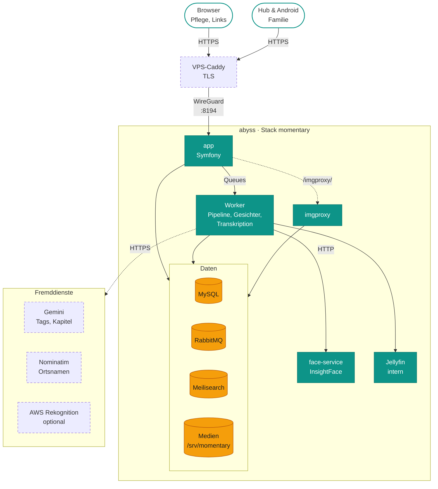

# Momentary – Überblick

Alte Homevideos und Fotos: <em>wer, wann, wo</em> – endlich auffindbar.

Momentary nimmt Kassetten-Digitalisate, Handyvideos und Fotos auf, erkennt Gesichter, Szenen und das Gesprochene und macht daraus ein durchsuchbares Familienarchiv mit Zeitachse, Ereignissen und Karte.

<ol>
<li data-title="Hochladen & Import" data-icon="folder" data-badges="Video & Foto|Doppelte raus|ganze Karten">

Dateien oder ganze Ordner per Browser hochladen, große Mengen über den Import-Ordner. Doppelte erkennt Momentary am Fingerabdruck der Datei und lädt sie gar nicht erst hoch.

</li>
<li data-title="Gesichter erkennen" data-icon="users" data-badges="InsightFace|lokal|Tinder-Stil">

Jedes Video wird in Szenen und Einzelbilder zerlegt, Gesichter werden auf dem eigenen Server erkannt und zu Personen gruppiert – auch über Jahrzehnte, vom Kind bis zur Oma. Benennen geht im Tinder-Stil: Vorschlag annehmen, unbekannt oder überspringen – auch per Tastatur.

</li>
<li data-title="Zeitachse & Ereignisse" data-icon="calendar" data-badges="Vorschläge|Kamera-Uhr|DV-Datum">

Alles nach Aufnahmezeit, gruppiert nach Tagen und Ereignissen. Momentary schlägt Ereignisse wie „Urlaub“ selbst vor, korrigiert falsch gestellte Kamera-Uhren und liest bei MiniDV-Kassetten das echte Aufnahmedatum.

</li>
<li data-title="Suchen im Gesprochenen" data-icon="search" data-badges="Whisper|zur Sekunde|SRT-Untertitel">

Der Ton wird lokal verschriftlicht. Die Suche findet Namen, Orte und Sätze und springt im Video direkt an die Stelle, an der sie fallen.

</li>
<li data-title="Karte & Orte" data-icon="map" data-badges="EXIF & GPS|OpenStreetMap|Ortsnamen">

Fotos und Videos mit Standort erscheinen auf einer Karte und bekommen einen Ortsnamen wie „Cala d'Or, Spanien“ als Schlagwort.

</li>
<li data-title="Teilen per Link" data-icon="lock" data-badges="ohne Konto|mit Ablauf|Passwort">

Ein Ereignis oder ein einzelnes Video als Link für Verwandte – befristet, optional mit Passwort, ohne Gesichter, Namen oder Zugang zum übrigen Archiv.

</li>
</ol>
<ul class="hl-showcase__tags"><li>Pools für die Familie</li><li>Serienfotos zusammengefasst</li><li>Kapitel per KI</li><li>Titel per KI</li><li>Doppelte Personen finden</li><li>Web-Fassung fürs Handy</li><li>Untertitel in Jellyfin</li><li>Kiosk am Fernseher</li><li>Android-App mit Cast</li><li>HEIC vom iPhone</li><li>Interlacing erkannt</li><li>Import-Ordner</li><li>REST-API</li></ul>

Momentary ist das **Familienarchiv für Videos und Fotos**, vor allem für alte Homevideos (VHS, Hi8, MiniDV). Jedes
Video läuft nach dem Hochladen durch eine Pipeline: umwandeln, Szenen erkennen, Gesichter finden und Personen
zuordnen, Schlagworte und Kapitel per Gemini, eine leichte Web-Fassung und zum Schluss die Transkription. Daraus
entstehen Zeitachse, Ereignisse, Suche und Karte. Die Familie schaut sich das Archiv in der Web-Oberfläche oder über
den Kiosk **momentary-hub** (`momentary.wh-company.com`) und die Android-App an.

-   :material-account-group-outline:{ .lg } **Für wen**

    ---

    Die Familie: wer das Archiv pflegt, und Verwandte, die sich Videos und Fotos anschauen – am Rechner, am Tablet
    oder per Cast am Fernseher. Verwandte ohne Konto bekommen einen Link.

-   :material-movie-search-outline:{ .lg } **Was es kann**

    ---

    Hochladen und importieren, Gesichter erkennen und benennen, Zeitachse, Ereignisse, Suche bis ins Gesprochene,
    Karte, Share-Links. Dazu eine REST-API für Hub und Android-App.

-   :material-shield-lock-outline:{ .lg } **Wer was darf**

    ---

    **Familie** sieht öffentliche Medien und die ihrer **Pools**. **Bearbeiter** laden hoch und benennen Personen.
    **Admins** sehen und dürfen alles. Eine Sichtbarkeitsregel gilt überall: Listen, Suche, Karte, API, Links.

## In Zahlen

  
<b>11</b>Dienste dazu migrate und backup

  
<b>26</b>Pipeline-Schritte je Video

  
<b>27</b>Entities Doctrine, 19 Migrationen

  
<b>113</b>Routen davon 24 unter /api

  
<b>38</b>Konsolenbefehle app:…

  
<b>0</b>Medien offsite nur DB und Schlüssel

*Gezählt im Code (Stand November 2026): Dienste aus `compose.prod.yaml`, Routen über `debug:router`, Befehle über
`bin/console list app`.*

## Architektur

*Ein Compose-Stack auf abyss mit genau einem Host-Port (8194, nur auf der WireGuard-Adresse). Bilder laufen über
`app` zu imgproxy, alles Rechenintensive in den Workern. Fremddienste: Gemini für Texte, Nominatim für Ortsnamen,
AWS nur, wenn auf Rekognition umgestellt ist.*

- **app** (Apache + PHP 8.5, Symfony 8.1, API Platform): Web-Oberfläche mit Twig und Live Components, REST-API mit
  OAuth2 für Hub und Android-App, signierte Video-Streams.
- **Worker** sind drei Container aus demselben Image: `messenger-worker` (Pipeline, Fotos, Import, Zeitplan),
  `face-worker` (Gesichter, ein Bild zur Zeit) und `transcription-worker` (Whisper, niedrige Priorität).
- **face-service** ist ein eigener Python-Dienst (FastAPI, InsightFace) ohne Zugriff auf den Speicher; Bilder kommen
  per HTTP.
- **Jellyfin** ist nur Exportziel der Pipeline (mit Untertiteln) und von außen nicht erreichbar.
- Der **Hub** (`momentary-hub`, eigenes Repo und eigener Stack) hängt am Docker-Netz `momentary_momentary-network`
  und spricht das Backend intern an.

## Weiterlesen

| Seite | Inhalt |
|---|---|
| [Aufbau](aufbau.md) | Abläufe aus Nutzersicht, Pipeline, Gesichtserkennung, Datenmodell, Zustände |
| [Betrieb](betrieb.md) | Deploy, Rollback, Dienste, Hintergrundjobs, Variablen |
| [Daten](daten.md) | Was wo liegt, Backup und Wiederherstellung |
| [Wenn's hakt](probleme.md) | Symptome, Ursachen, Abhilfe |

Ausführliche Doku im Repo:
[Einstieg](https://github.com/rextuus/momentary/blob/main/documentation/index.md) ·
[Medien & Ereignisse](https://github.com/rextuus/momentary/blob/main/documentation/media.md) ·
[Pipeline](https://github.com/rextuus/momentary/blob/main/documentation/processing_pipeline.md) ·
[Gesichtserkennung](https://github.com/rextuus/momentary/blob/main/documentation/face_recognition.md) ·
[Transkription](https://github.com/rextuus/momentary/blob/main/documentation/transcription.md) ·
[Pools](https://github.com/rextuus/momentary/blob/main/documentation/pools.md) ·
[Share-Links](https://github.com/rextuus/momentary/blob/main/documentation/sharing.md) ·
[API-Vertrag](https://github.com/rextuus/momentary/blob/main/documentation/clients/API.md) ·
[Deployment](https://github.com/rextuus/momentary/blob/main/documentation/deployment.md)
