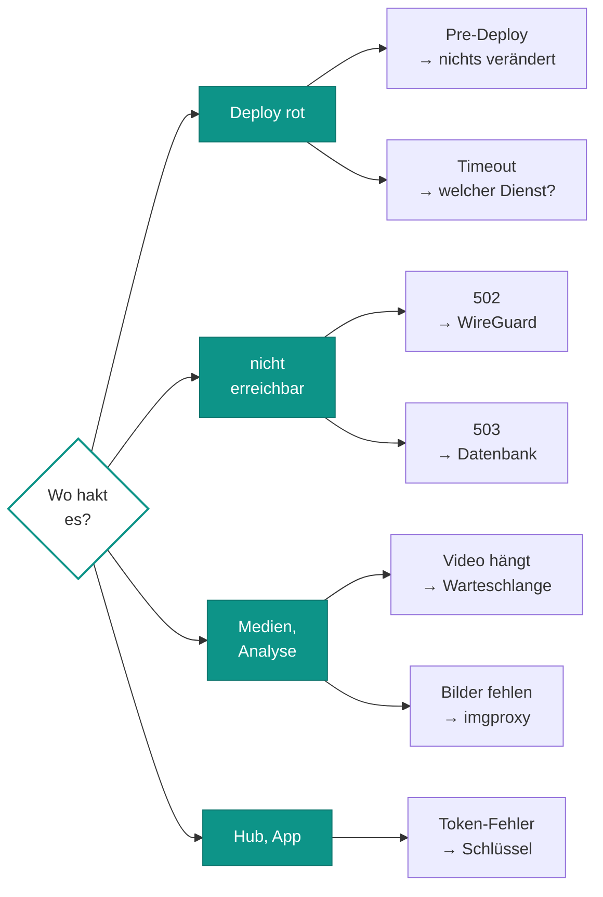

# Wenn's hakt

*Erste Frage: Wo bricht es ab? Das Komodo-Deploy-Log zeigt jede Stufe einzeln, im Betrieb helfen `dc ps` und
`dc logs <dienst>` ([Kurzform `dc`](betrieb.md#haufige-befehle)).*

## Deploy

??? failure "Pre-Deploy rot: „In Komodo fehlen diese Variablen/Secrets“"
    **Ursache:** Ein `[[MOMENTARY_…]]` im Environment von `momentary.toml` hat keine Komodo-Variable. Komodo lässt
    den Platzhalter dann wörtlich stehen, ohne Fehler zu melden.

    **Abhilfe:** Variable unter *Settings → Variables* genau mit dem angezeigten Namen anlegen (Häkchen „Secret“) oder
    die Zeile aus dem Environment nehmen. Es wurde nichts verändert, einfach neu deployen.

??? failure "Pre-Deploy rot wegen `VOLUME_PREFIX`"
    **Ursache:** Projektname und Volumes passen nicht zusammen. In Produktion (Projekt `momentary`) darf
    `VOLUME_PREFIX` nicht gesetzt sein; ein Probelauf braucht beides, eigenes Projekt und eigenes Präfix.

    **Abhilfe:** `VOLUME_PREFIX` aus dem Environment entfernen.

??? failure "„bind source path does not exist“"
    **Ursache:** `/srv/momentary/storage`, `…/keys` oder `…/backups` fehlt. Docker legt die Ordner absichtlich nicht
    selbst an, damit ein Tippfehler nicht ins Leere schreibt.

    **Abhilfe:** Ordner wie in der
    [Inbetriebnahme](https://github.com/rextuus/momentary/blob/main/documentation/deployment.md#3-abyss-vorbereiten)
    anlegen, neu deployen.

??? failure "Deploy hängt bis zum Timeout"
    **Ursache:** Ein Dienst wird nicht gesund. Häufig: `migrate` mit „Access denied“, weil Datenbank-Passwörter nach
    dem ersten Start geändert wurden. Beim ersten Start braucht `face-service` bis zu 5 Minuten für die Modelle.

    **Abhilfe:** `dc ps` – welcher ist nicht „healthy“? `dc logs <dienst>`. Bei „Access denied“ die alten Werte in
    Komodo zurücksetzen.

??? failure "Compose Up: „failed commit on ref layer-sha256:…“"
    **Ursache:** Zwei parallele Downloads derselben Image-Schicht (containerd-Image-Store).

    **Abhilfe:** Erneut deployen. `pre-deploy.sh` holt fehlende Fremd-Images inzwischen einzeln vorab.

??? failure "Seite unten nach dem Deploy, `migrate` exited ≠ 0"
    **Ursache:** Eine Migration ist gescheitert; `app` und Worker starten dann absichtlich nicht.

    **Abhilfe:** `dc logs migrate`. Fehler beheben oder [Rollback](betrieb.md#rollback) mit dem Pre-Deploy-Dump.

## Erreichbarkeit

??? failure "502 vom VPS"
    **Ursache:** Der VPS-Caddy erreicht `10.0.0.2:8194` nicht.

    **Abhilfe:** Auf dem VPS `curl http://10.0.0.2:8194/healthz`, WireGuard prüfen (`sudo wg show`), läuft der Stack?

??? failure "`/healthz` liefert 503"
    **Ursache:** Die Datenbank ist nicht erreichbar.

    **Abhilfe:** `dc logs database`.

??? failure "Links mit `http://`, Anmeldung springt zurück zum Login"
    **Ursache:** Symfony erkennt den Proxy nicht.

    **Abhilfe:** `APP_PUBLIC_URL` mit `https://`, `REVERSE_PROXY_IPS=10.0.0.1`.

## Medien und Analyse

??? failure "Video bleibt bei „wird verarbeitet“ stehen"
    **Ursache:** Meist ein externer Dienst: Gemini-Schlüssel fehlt oder Kontingent erschöpft, Jellyfin-Export ohne
    `JELLYFIN_API_KEY`, `face-service` nicht gesund.

    **Abhilfe:** *Verwalten → Warteschlange* zeigt wartende Nachrichten und aktive Worker je Queue und markiert
    Queues, die liegen bleiben. Dann `dc logs messenger-worker` bzw. `dc logs face-worker` und
    `messenger:failed:show` / `messenger:failed:retry`. Ein endgültig gescheiterter Schritt setzt das Video auf
    „Fehler“ mit Grund.

??? failure "Bilder und Vorschauen fehlen"
    **Ursache:** `imgproxy` nicht gesund, `IMGPROXY_KEY`/`SALT` passen nicht (403 beim direkten Öffnen) oder die
    Rechte im Speicher sind zu eng.

    **Abhilfe:** `dc ps imgproxy`; Schlüssel prüfen; Speicher nie auf `700`/`600` setzen.

??? failure "Suche leer oder Meilisearch startet nach einem Versionswechsel nicht"
    **Abhilfe:** Stack stoppen, `sudo docker volume rm momentary_meilisearch_data`, deployen, dann
    `app:meilisearch:index-all`. Der Index ist reine Ableitung aus der Datenbank.

??? failure "Transkription dauert ewig oder startet von vorn"
    **Ursache:** Whisper braucht auf abyss grob so lange wie das Video selbst. Ein Deploy oder ein Neustart des
    Workers bricht sie ab; die Queue wiederholt absichtlich nicht.

    **Abhilfe:** Auf der Videoseite *Neu transkribieren* oder `app:video:transcribe <id>`; vor Deploys auf eine leere
    Queue `transcription` warten.

## Hub und Android-App

??? failure "API-Clients melden „invalid key“ oder 500 beim Token"
    **Ursache:** Schlüsselpaare unter `/srv/momentary/keys` fehlen oder sind vertauscht.

    **Abhilfe:** `dc logs app`; nach dem Austausch `dc restart app`. Neue Schlüssel machen ausgegebene Tokens
    ungültig, Hub und App melden sich dann neu an.

??? failure "Hub sieht das Backend nicht"
    **Ursache:** Der Hub hängt nicht am Netz `momentary_momentary-network`.

    **Abhilfe:** `sudo docker network inspect momentary_momentary-network`, Hub-Stack neu deployen.

## Sicherung

??? failure "Backup-Procedure schlägt fehl"
    **Ursache:** Der Stack läuft nicht (die Procedure startet die Datenbank absichtlich nicht selbst) oder
    `/srv/momentary/backups` fehlt.

    **Abhilfe:** Stack starten, Log der Procedure ansehen, Ordner prüfen.

Vollständige Fehlersuche:
[documentation/deployment.md → Fehlersuche](https://github.com/rextuus/momentary/blob/main/documentation/deployment.md#fehlersuche).
