# Video-Verarbeitung (Pipeline)

Ein Video durchläuft eine feste Kette von Schritten. Jeder Schritt ist eine Messenger-Message mit eigenem Handler; der
Status steht auf der `Video`-Entity und wird von der **State Machine** `video_processing`
(`config/packages/workflow.yaml`) geführt. Stand: November 2026, abgeglichen mit
`bin/console app:video:processing-pipeline:show` (zeigt die Kette aus dem Code) und `messenger.yaml`.

## Schritte

„Transition“ heißt: Nach dem Schritt wechselt der Status über diese Transition, bevor die nächste Message
verschickt wird. Schritte mit „First/…/Last“ verarbeiten eine Liste (Frames, Szenen) Message für Message.

| # | Schritt | Message | Status | Transition danach | Transport |
|---|---------|---------|--------|-------------------|-----------|
| 1 | In MP4 umwandeln | `ConvertStepMessage` | `converting` | `start_scene_detection` | async_video_processing |
| 2 | Szenen erkennen | `SceneDetectionStepMessage` | `scene_detection` | `start_extracting_thumbnails` | async_video_processing |
| 3–5 | Szenen-Vorschaubilder | `Extract{First,,Last}SceneThumbnailStepMessage` | `extracting_thumbnails` | nach 5: `start_splitting` | async_video_processing |
| 6 | Ganzes Video in Frames zerlegen | `SplitVideoInFramesStepMessage` | `video_splitting` | `start_analyzing` | async_video_processing |
| 7–9 | Gesichter in den Frames | `Analyze{First,,Last}VideoFrameStepMessage` | `analyzing_faces_initial` | nach 9: `start_refining_extraction` | **face_recognition** |
| 10 | Szenen ohne Gesicht für das Refinement auswählen | `InitRefinementForEmptyScenesStepMessage` | `refining_extraction` | `start_refining_splitting` | async_video_processing |
| 11–13 | Diese Szenen dichter in Frames zerlegen | `Split{First,,Last}SceneInFramesStepMessage` | `refining_splitting` | nach 13: `start_refining_analysis` | async_video_processing |
| 14–16 | Gesichter in den Refinement-Frames | `Analyze{First,,Last}SceneFrameStepMessage` | `analyzing_faces_refinement` | nach 16: `start_face_consolidation` | **face_recognition** |
| 17 | Gesichter im Video abgleichen | `ConsolidateFacesStepMessage` | `consolidating_faces` | `start_merging` | async_video_processing |
| 18 | Leere Szenen zusammenlegen | `MergeScenesStepMessage` | `merging_scenes` | `start_tagging` | async_video_processing |
| 19–21 | Szenen taggen (Gemini) | `Tag{First,,Last}SceneStepMessage` | `tagging_scenes` | nach 21: `start_chapter_generation` | async_video_processing |
| 22 | Kapitel erzeugen | `GenerateChapterStepMessage` | `chapter_generation` | `start_naming` | async_video_processing |
| 23 | Titel vorschlagen | `VideoNamingStepMessage` | `naming` | `start_export` | async_video_processing |
| 24 | Nach Jellyfin exportieren | `UploadToJellyfinStepMessage` | `exporting_jellyfin` | `start_web_encoding` | async_video_processing |
| 25 | Web-Fassung kodieren | `EncodeWebStepMessage` | `encoding_web` | `start_transcription` | async_video_processing |
| 26 | Ton transkribieren (abschaltbar) | `TranscribeStepMessage` | `transcribing` | `complete` | **transcription** |

### Worker und Transports

| Transport | Worker (Compose-Dienst) | Inhalt |
|-----------|-------------------------|--------|
| `async_video_processing`, `async`, `photos`, `scheduler_default` | `messenger-worker` | alle übrigen Pipeline-Schritte, Import, Fotos, Zeitplan |
| `face_recognition` | `face-worker` (genau ein Consumer) | Frame-Analyse 7–9 und 14–16; der Worker ruft den `face-service` auf |
| `transcription` | `transcription-worker` | Schritt 26 und manuell angestoßene Transkriptionen |

Die Kette wechselt dabei zwischen den Workern: Nach Schritt 9 schickt der `face-worker` die Message für Schritt 10
auf `async_video_processing` usw. `face_recognition` hat genau einen Consumer, damit nie zwei Frames gleichzeitig beim
face-service landen (`documentation/face_recognition.md`). Retries dort: 3× mit 5 s, 15 s, 45 s; danach `failed`,
und `FailedStepSubscriber` setzt das Video auf `error`.

Wird ein Video gelöscht, während eine seiner Messages unterwegs ist, wirft der Handler `VideoGoneException`;
`DiscardGoneVideoMessageMiddleware` verwirft die Message dann still (kein Retry, kein `failed`).

### Refinement überspringen

Das Refinement (10–16) analysiert Szenen ohne Gesicht noch einmal mit `REFINED_FRAME_ANALYSIS_FPS`. Ist die
Erstanalyse schon mindestens so dicht (`FRAME_ANALYSIS_FPS` bzw. die Werte am Video ≥ Refinement-fps), wählt Schritt
10 keine Szene aus. Die Schritte 11–16 laufen trotzdem durch und setzen ihre Zustände, nur ohne Arbeit; die State
Machine kommt so unverändert bei `consolidating_faces` an (Test: `VideoProcessingPipelineTest::
testRefinementIsSkippedWhenFirstAnalysisIsAlreadyDenseEnough`).

## Zustände (State Machine)

`pending` → `converting` → `scene_detection` → `extracting_thumbnails` → `video_splitting` →
`analyzing_faces_initial` → `refining_extraction` → `refining_splitting` → `analyzing_faces_refinement` →
`consolidating_faces` → `merging_scenes` → `tagging_scenes` → `chapter_generation` → `naming` →
`exporting_jellyfin` → `encoding_web` → `transcribing` → `completed`; außerdem `error`.

`queued` liegt außerhalb der State Machine: Neue und neu zu verarbeitende Videos warten dort, bis die
Import-Warteschlange (`ImportQueueManager`) sie direkt auf `converting` setzt und Schritt 1 verschickt.

## Transitions

| Transition | von | nach |
|------------|-----|------|
| `start_conversion` | `pending` | `converting` |
| `start_scene_detection` | `converting` | `scene_detection` |
| `start_extracting_thumbnails` | `scene_detection` | `extracting_thumbnails` |
| `start_splitting` | `extracting_thumbnails` | `video_splitting` |
| `start_analyzing` | `video_splitting` | `analyzing_faces_initial` |
| `start_refining_extraction` | `analyzing_faces_initial` | `refining_extraction` |
| `start_refining_splitting` | `refining_extraction` | `refining_splitting` |
| `start_refining_analysis` | `refining_splitting` | `analyzing_faces_refinement` |
| `start_face_consolidation` | `analyzing_faces_refinement` | `consolidating_faces` |
| `start_merging` | `consolidating_faces` | `merging_scenes` |
| `start_tagging` | `merging_scenes` | `tagging_scenes` |
| `start_chapter_generation` | `tagging_scenes` | `chapter_generation` |
| `start_naming` | `chapter_generation` | `naming` |
| `start_export` | `naming` | `exporting_jellyfin` |
| `start_web_encoding` | `exporting_jellyfin` | `encoding_web` |
| `start_transcription` | `encoding_web` | `transcribing` |
| `complete` | `transcribing` | `completed` |
| `fail` | jeder Zustand von `pending` bis `transcribing` | `error` |
| `reset` | jeder Zustand von `converting` bis `transcribing` sowie `error` | `pending` |

```mermaid
stateDiagram-v2
    [*] --> pending
    pending --> converting : start_conversion
    converting --> scene_detection : start_scene_detection
    scene_detection --> extracting_thumbnails : start_extracting_thumbnails
    extracting_thumbnails --> video_splitting : start_splitting
    video_splitting --> analyzing_faces_initial : start_analyzing
    analyzing_faces_initial --> refining_extraction : start_refining_extraction
    refining_extraction --> refining_splitting : start_refining_splitting
    refining_splitting --> analyzing_faces_refinement : start_refining_analysis
    analyzing_faces_refinement --> consolidating_faces : start_face_consolidation
    consolidating_faces --> merging_scenes : start_merging
    merging_scenes --> tagging_scenes : start_tagging
    tagging_scenes --> chapter_generation : start_chapter_generation
    chapter_generation --> naming : start_naming
    naming --> exporting_jellyfin : start_export
    exporting_jellyfin --> encoding_web : start_web_encoding
    encoding_web --> transcribing : start_transcription
    transcribing --> completed : complete
    completed --> [*]
```

`fail` und `reset` sind der Übersicht halber nicht eingezeichnet.
